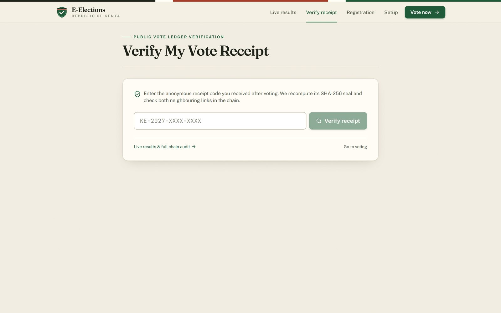
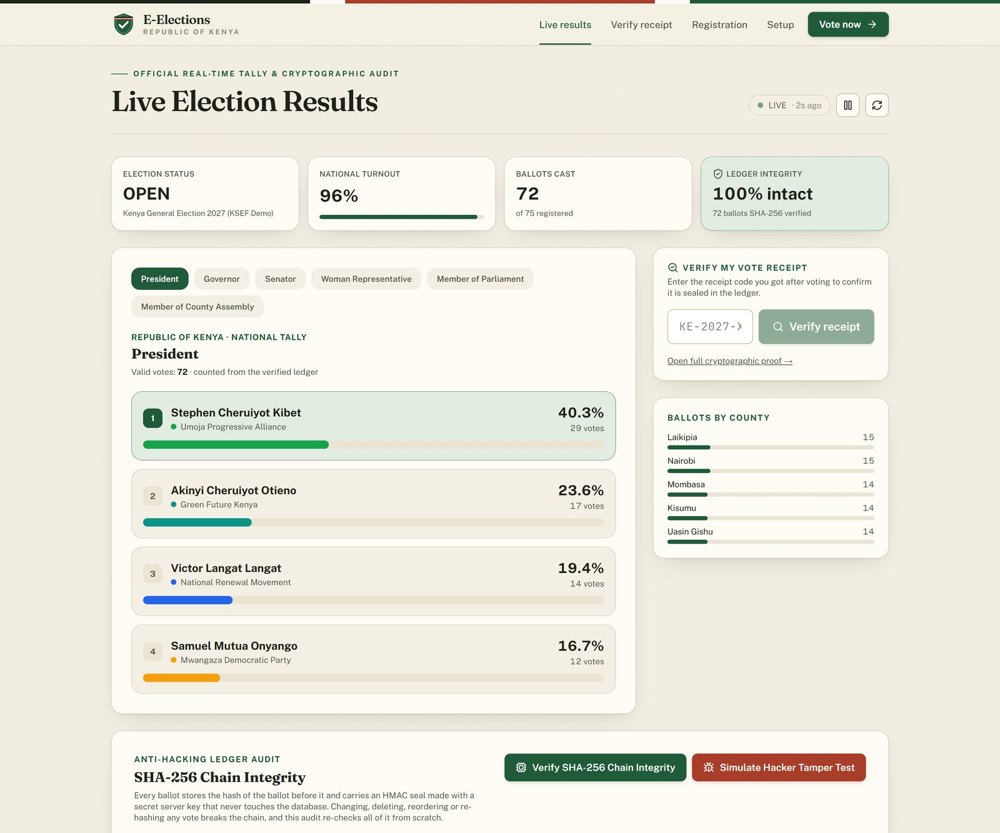

<p align="center">
  
</p>

<h1 align="center">E-ELECTIONS</h1>
<p align="center"><b>Every Kenyan vote, counted in the open.</b><br>
A secure biometric digital voting and real-time tallying system for Kenya.</p>

---

## Why

Kenya's elections are slow, expensive and often disputed. Voters can only vote where they registered, counting takes days, and in 2017 the Supreme Court annulled the presidential result over how results were transmitted. The 2027 General Election budget is about **KSh 74.8 billion**.

E-ELECTIONS shows how voting could be **cheaper, faster, accessible from anywhere and verifiable by anyone**, while keeping every ballot secret.

> Built by Jeremy Gachiki Nduati (16, Kenya) as a Kenya Science and Engineering Fair (KSEF) 2027 project. This is a research prototype, not an IEBC system. See [Status](#status).

## How it works

1. **Identify.** The voter enters their National ID. Anyone who has already voted is stopped here.
2. **Verify.** A face scan (look at the camera, then three random moves: about 5 seconds) checked entirely **on the server** with ArcFace, the face model behind leading research systems, **or** the device's fingerprint sensor through WebAuthn. The fingerprint never leaves the phone.
3. **Vote from anywhere.** The voter automatically gets the ballot for their own county, constituency and ward, plus the presidential race: six seats, as in a Kenyan general election.
4. **Sealed receipt.** The ballot is stored with no name or ID, chained to the previous ballot by SHA-256 and sealed with an HMAC. The voter gets an anonymous receipt code to check later.
5. **Live results.** Results are recomputed from the verified ledger and refresh every 3 seconds, by county, constituency and ward.

**English and Kiswahili.** The whole site switches language from the top bar (EN | SW), including the messages the server sends; every Kiswahili text is type-checked against the English, so none can be missing.

Feature phones are supported too: a `*2027#` **USSD** gateway (Africa's Talking protocol, SIM-bound plus a PIN) uses the same ballot pipeline.

| Verify your receipt | Live results and chain audit |
|---|---|
|  |  |

*Screenshots use fictional test data.*

## Security highlights

- **Tamper-evident ledger:** each ballot carries the SHA-256 hash of the one before it, plus a server HMAC seal whose key never touches the database. Change, delete or reorder one ballot and the chain breaks; rewriting the whole chain is caught by the seals. Each county has its own chain (so counties never queue behind each other), and one Merkle root fingerprints the whole election.
- **One voter, one ballot:** the check-and-cast happens in a single atomic database transaction, so simultaneous attempts cannot slip a second ballot through.
- **Biometrics encrypted at rest:** face templates use AES-256-GCM, bound to the voter's ID, so encrypted faces cannot be swapped between records (Kenya Data Protection Act 2019 treats biometrics as sensitive data).
- **Server-side face recognition:** the browser only sends camera frames; the server detects the face (SCRFD), aligns it on 5 points and turns it into a 512-number identity vector (ArcFace ResNet-50, trained on WebFace600K, chosen for its accuracy on African faces). **99.85% on the LFW benchmark** (10-fold), and 0 false accepts in 3,000 impostor pairs at the threshold used. A one-to-many check against the whole register (in-memory face index) rejects lookalikes and double registrations.
- **Liveness check:** every scan gets a random order of moves (turn left, turn right, blink) in a single-use token. The server checks the frames itself: the head really turned the right way, the eyes really closed, and it was one person throughout. A passive anti-spoofing model also scores every scan for photos and screens.
- **Ballot secrecy:** the ledger holds no names or IDs, and the time a person voted is stored only to the hour.
- **Web hardening:** CSRF protection, a Content-Security-Policy, rate limiting with lockouts against brute force, and a security audit log.

Full details: [SECURITY.md](SECURITY.md).

## Tested

| Test | Result |
|---|---|
| Automated security suite (`scripts/security-test.ts`) | **39 / 39 passed** |
| Face engine on real photos (`scripts/face-engine-test.ts`) | **13 / 13 passed** |
| Face verification accuracy, LFW 6,000 pairs (`scripts/benchmark-lfw.ts`) | **99.85%** (± 0.17); 0 / 3,000 false accepts and 99.07% true accepts at the app's threshold |
| Server time for one face scan (6 frames, laptop) | ≈ 0.8 s |
| 1:N face search, 1 million voters (all CPU cores, 8-bit index) | ≈ 0.2 s, 0.5 GB |
| Simulated election: voters registered | 70 / 70 |
| Double-voting attempts blocked | 30 / 30 |
| Simultaneous duplicate ballots | 10 accepted of 30 submitted (1 per voter) |
| Receipts verified against the ledger | 70 / 70 |
| Brute-force face logins | locked after 5 failures |

The election simulation stands in for the face match with the signed session the server issues after one (the server refuses simulated faces); face checking is tested on real photos. Raw results: [`scripts/e2e-results.json`](scripts/e2e-results.json), [`scripts/lfw-results.json`](scripts/lfw-results.json).

## Tech stack

Next.js 16 (App Router), React 19, TypeScript, MongoDB with Mongoose, ONNX Runtime (server face engine: SCRFD, ArcFace, MiniFASNet), Google MediaPipe (camera guidance in the browser), SimpleWebAuthn (fingerprint / passkeys), `jose` (sessions), Tailwind CSS, Recharts.

## Run it locally

Requirements: Node.js 20+ and a MongoDB database (MongoDB Atlas free tier works; transactions need a replica set, which Atlas provides).

```bash
git clone https://github.com/jeremydev-c/e-elections.git
cd e-elections
npm install
cp .env.example .env.local      # then fill in MONGODB_URI and SESSION_SECRET
npx tsx scripts/fetch-face-models.ts   # face models (~200 MB, checksummed) into ml-models/
npm run seed                    # demo regions, candidates and an admin account
npm run dev                     # http://localhost:3000
```

Run the security tests (no database needed):

```bash
npx tsx scripts/security-test.ts
```

Face recognition and fingerprints need a secure context: use `localhost`, or an HTTPS tunnel when testing on a phone.

## Project layout

```
src/app/          pages (vote, verify, ballot, results, register, setup) and API routes
src/lib/          hash chain, ledger, biometric vault, face maths, WebAuthn, rate limiting, audit log
src/models/       MongoDB models (Voter, Candidate, VoteLedger, Election, AuditLog)
scripts/          seeding, admin reset, security tests, end-to-end election test
public/mediapipe/ camera face tracker (MediaPipe, self-hosted)
ml-models/        server face models (downloaded, not in the repository)
data/             Kenya counties, constituencies and wards
```

## Status

E-ELECTIONS is a **prototype for research and demonstration**, built for KSEF 2027. It is not affiliated with or approved by the IEBC, and it should not be used for binding public elections without independent security audits, legal approval and a pilot programme. Small elections (school councils, clubs, associations) are the next step.

## Contributing and security reports

Ideas, issues and pull requests are welcome. If you find a security weakness, please read [SECURITY.md](SECURITY.md) and report it privately first.

## License

[GNU AGPL-3.0](LICENSE). You may use, study and modify E-ELECTIONS, but if you run a modified version as a service you must publish your source code too. Election software should stay open.

## Author

**Jeremy Gachiki Nduati**: self-taught developer from Kenya.
